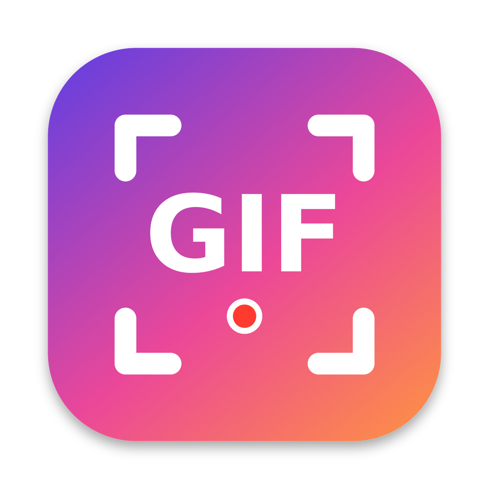

# Giffie

**Record any part of your screen as an animated GIF, right from the macOS menu bar.**

Giffie is a small, native menu bar app in the spirit of [Gifox](https://gifox.app): pick an area, press
<kbd>Space</kbd>, and a GIF lands in your folder and in a drag-and-drop list in the menu bar.

<p align="center"></p>

## Download

Grab **`Giffie-<version>.dmg`** from the [latest release](https://github.com/nagarsuresh/giffie/releases/latest),
open it and drag **Giffie** to **Applications**. Requires macOS 13 Ventura or later. It's a universal build, so it
runs on both Apple Silicon and Intel Macs.

> **First launch:** release builds are ad-hoc signed, not notarized by Apple, so macOS blocks the first launch.
> * macOS 15 Sequoia or later: open Giffie once, click **Done**, then go to **System Settings → Privacy & Security**
>   and click **Open Anyway** next to Giffie.
> * macOS 13–14: right-click Giffie in Applications → **Open** → **Open**.
> * Or run `xattr -dr com.apple.quarantine /Applications/Giffie.app` in Terminal.

## Using Giffie

1. **First run:** Giffie asks **where to save your GIFs** (it suggests `~/Pictures/Giffie`), then for
   **Screen Recording** permission. Allow it under *System Settings → Privacy & Security → Screen Recording*,
   then relaunch Giffie.
2. **Start:** click the menu bar icon → **Record**, or press **⌥⇧⌘G** from anywhere. You can change the shortcut in Settings.
3. **Select:** drag over the area you want. Hover a window and click to snap to it, or click empty space for the
   whole screen. Adjust the selection with the handles, drag it to move it, or use the arrow keys
   (<kbd>⇧</kbd> moves 10 pt, <kbd>⌥</kbd> resizes).
4. **Record:** press <kbd>Space</kbd>, <kbd>Return</kbd> or click **Record**. A small HUD shows the time, the
   current file size and how close you are to the limits.
5. **Stop:** press <kbd>Space</kbd> or <kbd>Esc</kbd> while Giffie's overlay is focused, click **Stop** in the
   HUD, click the red menu bar icon, or press the shortcut again. The trash button throws the take away.
6. **Share:** the GIF list opens in the menu bar. **Drag a GIF into any app** (Slack, Mail, Messages, GitHub,
   Finder…). Dragging always copies, so the original stays in your folder. Double-click a GIF to open it; use the
   buttons or right-click to copy, show in Finder or trash.

### Limits

Recording stops automatically at **30 seconds** or **10 MB**, whichever comes first. Both are configurable
(10 s – 2 min; 5 – 50 MB or no size limit). The size limit is exact: Giffie checks every frame *before* it adds it,
so a saved GIF never grows past the limit.

### Settings

Save folder · frame rate (10–30 fps) · resolution (1x for small files, Retina 2x for crisp ones) · colors per
frame · countdown · show mouse pointer · window highlighting · time and size limits · show the list or copy to the
clipboard after recording · shortcut · launch at login.

## How it works

* **Capture:** ScreenCaptureKit streams only the selected rectangle, already scaled to the output size and
  converted to sRGB. Giffie's own overlay, toolbar and HUD are excluded from the capture.
* **Encoding while you record:** frames go straight into a custom streaming GIF89a encoder
  (`Sources/GiffieCore`), so a GIF is ready the moment you stop, and memory use stays flat however long the
  recording is:
  * only the bounding box of pixels that changed since the previous frame is stored, and unchanged pixels inside
    it are transparent. Static UI costs next to nothing.
  * identical frames are merged into longer delays.
  * each frame gets its own palette from just the changed pixels. If a frame has ≤ 256 colors (typical for UI) it
    is encoded losslessly; otherwise it uses median-cut quantization.
  * delays follow the real capture timestamps on a centisecond grid, so playback speed matches real time.
* **Library:** the menu bar list shows the newest GIFs in the save folder and refreshes when files change.

## Building from source

Requirements: Xcode 15 or later (Swift 5.9+) on macOS 13+.

```sh
swift test                  # GIF encoder tests (these also run on Linux)
./scripts/build-dmg.sh      # universal Giffie.app + build/Giffie-<version>.dmg
open build/Giffie.app
```

For a quick debug run: `swift run Giffie`. When run outside a `.app` bundle, macOS asks for Screen Recording
permission for your terminal instead.

`scripts/build-dmg.sh` ad-hoc signs by default. Set `CODESIGN_IDENTITY="Developer ID Application: …"` to sign
for distribution. Also set `NOTARY_APPLE_ID`, `NOTARY_TEAM_ID` and `NOTARY_PASSWORD` to notarize and staple
the DMG.

### Continuous integration and releases

`.github/workflows/build.yml` runs the encoder tests on Linux and macOS, builds the universal app and DMG on a
macOS runner, launches the app as a smoke test, and uploads the DMG as a build artifact. A GitHub Release
(`v<VERSION>`) with the DMG is published when:

* a `v*` tag is pushed,
* there is a push to the default branch, or
* the workflow is run manually with *publish_release*.

To produce signed and notarized releases, add these repository secrets: `MACOS_CERTIFICATE_P12` (base64 of your
Developer ID `.p12`), `MACOS_CERTIFICATE_PASSWORD`, `NOTARY_APPLE_ID`, `NOTARY_TEAM_ID` and `NOTARY_PASSWORD`
(an app-specific password).

### Project layout

```
Package.swift
Sources/GiffieCore/     streaming GIF encoder (LZW, quantizer, frame diffing, limits) – pure Swift
Sources/Giffie/         the macOS app (AppKit + SwiftUI + ScreenCaptureKit)
Tests/GiffieCoreTests/  encoder tests with an independent GIF decoder (+ ImageIO cross-check on macOS)
Resources/              Info.plist, app icon
scripts/                build-dmg.sh, make-icon.py
```

## Notes

* Giffie is an independent open-source project. It is not affiliated with Gifox and contains none of its code.
* Ad-hoc signed builds are identified by their code hash, so macOS may ask for Screen Recording permission again
  after you install an update. Developer ID–signed builds don't have this problem.
